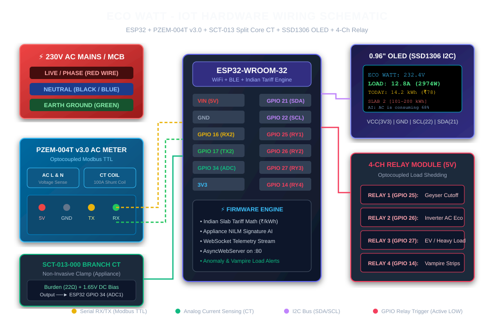

# ⚡ Eco Watt: Smart IoT Energy Monitor & AI Bill Optimizer

> **Problem Statement**: Homes and businesses frequently waste electricity and receive unexpectedly high bills because they cannot track real-time energy consumption, understand appliance-level current draw, or anticipate tariff slab jumps. 
> 
> **Eco Watt Solution**: An intelligent IoT and AI energy monitoring system that measures real-time current (Amperes), voltage, power, and kilowatt-hours (units). It breaks down consumption per appliance, models Indian state electricity board telescopic tariff slabs, and delivers proactive AI recommendations to systematically slash monthly electricity bills.



---

## 🌟 Key Highlights & Innovations

1. **Dual Hardware Sensor Support**:
   - **PZEM-004T v3.0**: High-precision optoisolated AC meter tracking RMS Voltage (80-260V), Current (0-100A), Active Power, Frequency, and Power Factor via Modbus TTL.
   - **SCT-013-000**: Non-invasive split-core Current Transformer for clamp-on sub-circuit and individual appliance branch monitoring without cutting any wires.
2. **Indian Telescopic Slab Tariff Engine**:
   - Models progressive tariff slabs (e.g., BESCOM Karnataka, MSEDCL Maharashtra, TNEB Tamil Nadu, BSES Delhi, UPPCL).
   - **Slab-Breach Defense**: Warns users before their monthly burn rate causes a leap into a penalizing, higher tariff slab (e.g. jumping from ₹4.75/unit to ₹8.50/unit).
3. **Appliance-Level Intelligence (NILM)**:
   - Identifies active appliances (1.5-Ton Inverter AC, Instant Water Geyser, Refrigerator, Induction Cooker, BLDC/Induction Fans, and Standby Vampire Load).
   - Displays real-time Current (A), Power (W), and today's accrued cost in Indian Rupees (₹).
4. **AI Bill-Reduction Advisory Engine**:
   - Generates actionable, quantified recommendations (e.g., adjusting AC thermostat by +2°C to save ₹780/month according to BEE standards; scheduling water geyser cutoff to save ₹480/month).
5. **Multi-Interface Access**:
   - Local on-device **0.96" SSD1306 OLED Display** for real-time glanceable stats.
   - Built-in ESP32 **Async Web Server & REST API** accessible via `http://ecowatt.local` or direct IP on any phone or laptop.
   - Standalone **interactive web dashboard** for simulation, demos, and hackathon presentations.

---

## 📁 Repository Directory Structure

```
eco watt/
├── firmware/
│   ├── include/
│   │   ├── TariffEngine.h          # Telescopic Indian Slab billing engine (C++)
│   │   └── AIEnergyAdvisor.h       # Appliance NILM disaggregation & AI rules (C++)
│   ├── esp32_ecowatt_pzem/
│   │   └── esp32_ecowatt_pzem.ino  # Production ESP32 firmware with PZEM-004T + WebServer
│   ├── esp32_ecowatt_sct013/
│   │   └── esp32_ecowatt_sct013.ino# ESP32 firmware with SCT-013-000 split-core CT
│   └── arduino_ecowatt_basic/
│       └── arduino_ecowatt_basic.ino# Budget Arduino Uno/Nano + 16x2 I2C LCD sketch
├── schematics/
│   ├── CIRCUIT_DIAGRAMS.md         # Complete circuit schematics & math calculations
│   └── wiring_diagram.svg          # High-resolution vector wiring diagram
├── tariff_engine/
│   └── indian_electricity_slabs.json # Configurable slabs for BESCOM, MSEDCL, TNEB, BSES, UPPCL
├── web_dashboard/                  # Standalone interactive dashboard & authentication
│   ├── index.html                  # Live appliance audit table & AI advisory
│   ├── login.html                  # Email & password authentication (Resident/Auditor)
│   ├── login.css                   # Cyber/dark glassmorphic design system
│   ├── login.js                    # Auth session state & validation logic
│   ├── style.css
│   └── app.js
└── README.md
```

---

## 🛠️ Hardware Bill of Materials (BOM)

| Component | Purpose | Pins / Interface | Approx. Cost (INR ₹) |
|---|---|---|---|
| **ESP32-WROOM-32** | Main Microcontroller & Web Server | 2.4GHz WiFi, Dual Core | ₹480 |
| **PZEM-004T v3.0** | Mains AC Voltage/Current Meter | Modbus TTL UART (GPIO 16/17) | ₹850 |
| **SCT-013-000** | Non-Invasive 100A:50mA CT Clamp | Analog GPIO 34 (with 22Ω Burden) | ₹390 |
| **SSD1306 0.96" OLED** | Local Status Display (128x64) | I2C (GPIO 21 SDA, 22 SCL) | ₹220 |
| **4-Channel 5V Relay** | Automated Eco-Cutoff Actuator | GPIO 25, 26, 27, 14 | ₹180 |
| **Hi-Link HLK-PM01** | 230V AC to 5V DC Isolated Supply | AC In, 5V/0.6A Out | ₹190 |
| **Resistors & Cap** | 22Ω 1%, 2x 100kΩ, 10µF Cap | CT Conditioning Bias Circuit | ₹30 |

---

## 🔌 Hardware Wiring & Pin Mapping

### 1. ESP32 to PZEM-004T v3.0 (AC Mains Meter)
- **VCC** ──► `ESP32 5V (VIN)`
- **GND** ──► `ESP32 GND`
- **TX**  ──► `ESP32 GPIO 16 (RX2)`
- **RX**  ──► `ESP32 GPIO 17 (TX2)`
- **AC Terminals** ──► 230V AC Mains (Phase & Neutral)
- **CT Coil** ──► Clamped around **Phase (Live) Wire ONLY**

### 2. ESP32 to SCT-013-000 (Appliance Branch Meter)
- Connect CT leads across a **22Ω Burden Resistor**.
- Connect one end to a **1.65V DC Bias** (voltage divider between 3.3V and GND using two 100kΩ resistors stabilized with a 10µF capacitor).
- Connect the signal line directly to **ESP32 GPIO 34 (ADC1)**.

### 3. ESP32 to SSD1306 0.96" OLED
- **VCC** ──► `3.3V`
- **GND** ──► `GND`
- **SDA** ──► `GPIO 21`
- **SCL** ──► `GPIO 22`

### 4. ESP32 to 4-Channel 5V Relay Module
- **IN 1 (Geyser)** ──► `GPIO 25`
- **IN 2 (AC Eco)**  ──► `GPIO 26`
- **IN 3 (Heavy Load)**──► `GPIO 27`
- **IN 4 (Vampire)** ──► `GPIO 14`

---

## 📈 Indian Telescopic Tariff Slab Mathematics

In Indian utilities, charges are progressive. Here is the mathematical calculation implemented in `firmware/include/TariffEngine.h`:

$$\text{Bill} = \text{Fixed Charges} + \sum_{i=1}^{N} \left( \text{Units in Slab } i \times \text{Rate}_i \right) + \text{FPPCA} + \text{Duty}$$

### Example Calculation (BESCOM Profile at 180 kWh Consumption):
1. **Slab 1 (0 to 100 kWh)**: $100 \times ₹4.75 = ₹475.00$
2. **Slab 2 (101 to 180 kWh)**: $80 \times ₹7.00 = ₹560.00$
3. **Fixed Meter Charge**: $₹90.00$
4. **FPPCA Fuel Surcharge**: $180 \times ₹0.45 = ₹81.00$
5. **Electricity Duty (9%)**: $0.09 \times (475 + 560 + 81) = ₹99.72$
6. **Total Monthly Bill**: **₹1,305.72**

> **AI Guideline Trigger**: If consumption projection shows 205 kWh, the remaining 5 units enter **Slab 3 @ ₹8.50/unit**. Eco Watt notifies the user: *"Reduce AC usage by 45 minutes daily to stay under 200 kWh and avoid Slab 3 charges."*

---

## 🚀 How to Flash the Firmware

1. Install the [Arduino IDE](https://www.arduino.cc/en/software) (or use PlatformIO in VS Code).
2. Install the **ESP32 Board Package**:
   - Go to `Preferences` -> Additional Board Manager URLs -> Add: `https://raw.githubusercontent.com/espressif/arduino-esp32/gh-pages/package_esp32_index.json`
   - Open `Board Manager`, search for `esp32` by Espressif and click **Install**.
3. Install required libraries from Arduino Library Manager (`Ctrl + Shift + I`):
   - `PZEM004Tv30` by Jakub Mandula
   - `Adafruit SSD1306` & `Adafruit GFX Library`
4. Open [esp32_ecowatt_pzem.ino](file:///c:/Users/Lenovo/OneDrive/Desktop/eco%20watt/firmware/esp32_ecowatt_pzem/esp32_ecowatt_pzem.ino).
5. Select Board: **ESP32 Dev Module**, select your COM port, and click **Upload**.
6. Open Serial Monitor at **115200 baud** to see live readings and your assigned local IP address!

---

## 💻 Running the Interactive Web Dashboard

To view or demo the Eco Watt dashboard on your computer:
1. Navigate to the `web_dashboard` folder.
2. Open `index.html` in any web browser (Chrome, Edge, Firefox).
3. The dashboard features live simulated telemetry, interactive state tariff switching, appliance load controls, and an AI chat assistant!
